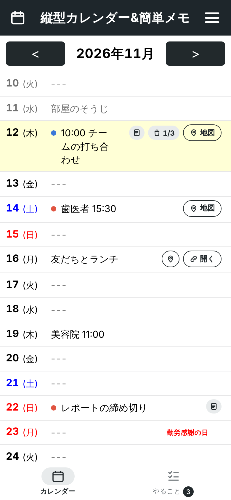
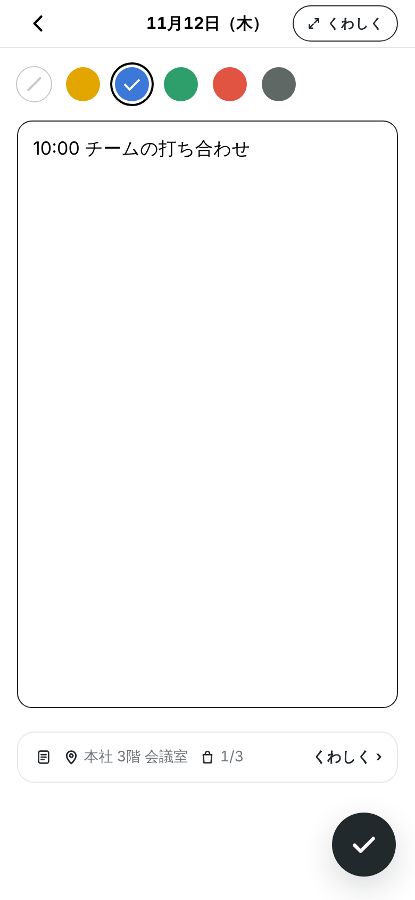
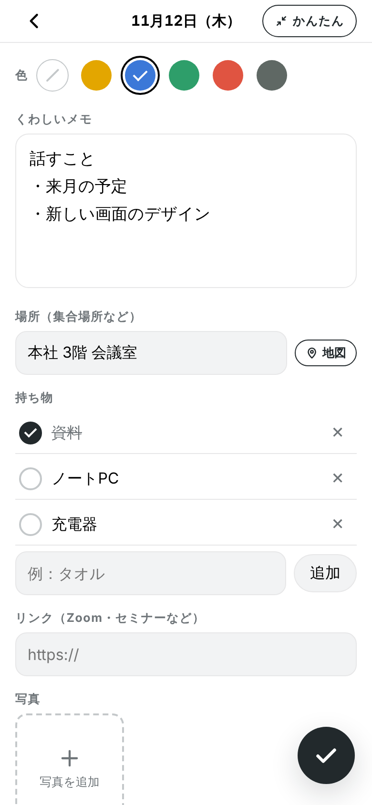
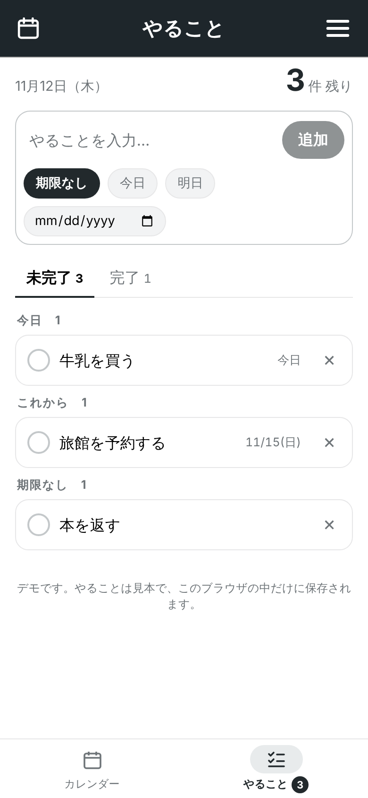
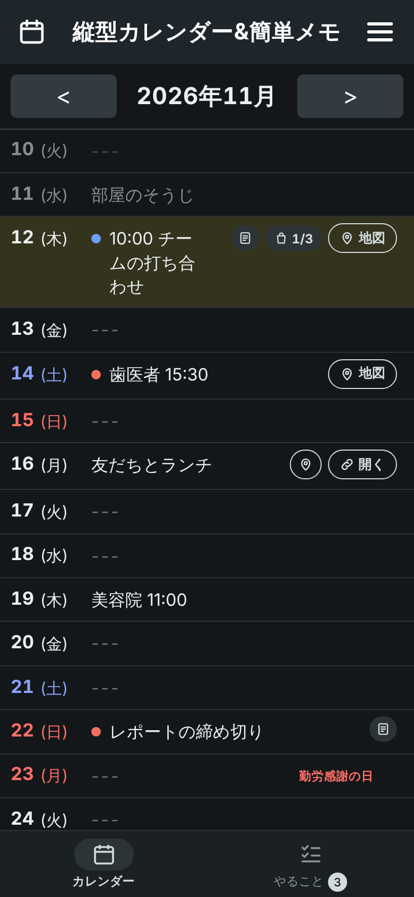

# 縦型カレンダー＆簡単メモ

1日を1行で並べる、スマホ向けの縦型カレンダーです。日付をタップしてすぐメモを書けて、iPhone とパソコンで同じ内容を見られます。自分で毎日使うために作りました。

**デモ（ログインなし）:** https://g27vv9dcnm-cmd.github.io/vertical-calendar/

> デモに入っている予定はすべて見本です。デモで書いた内容は、開いた人のブラウザの中だけに保存され、どこにも送られません。

| カレンダー | かんたん入力 | くわしく入力 | やること | 黒い画面 |
|---|---|---|---|---|
|  |  |  |  |  |

## できること

- **1日1行の縦型カレンダー**：土曜は青、日曜と祝日は赤。日本の祝日（振替休日・国民の休日を含む）はプログラムで計算しています。
- **かんたん入力とくわしく入力**：日付をタップすると、色とひとことメモだけの画面がすぐ開きます。「くわしく」に切りかえると、長いメモ・場所（Googleマップで開く）・持ち物リスト・リンク・写真を書けます。
- **写真のQRコード読み取り**：QRコードが写った写真を付けると、読み取ったURLをリンク欄に自動で入れます（jsQR）。
- **やることリスト**：期限（今日・明日・日付）ごとにまとめて表示し、消したものは元に戻せます。
- **オフライン**：電波がなくても開けて、見る・書くができます。つながったら自動で送ります。
- **ホーム画面に追加**（PWA）、白・黒・携帯の設定に合わせる、の画面の色の切りかえ。

## 使った技術

| | |
|---|---|
| 画面 | HTML / CSS / JavaScript（フレームワークなし、1ファイル） |
| ログイン | Firebase Authentication（Google） |
| データ | Cloud Firestore（月ごとに1つの文書） |
| 写真 | Cloud Storage for Firebase |
| 公開 | Firebase Hosting（本番）、GitHub Pages（デモ） |
| オフライン | Firestore のオフライン保存 + Service Worker |
| テスト | Firebase エミュレーター + Playwright |

## 工夫したところ

- **保存先を差しかえられる作り**：画面のコードは「読む・書く・写真を送る」だけを知っていて、保存先は起動時に選びます（Firebase／ブラウザの中（IndexedDB）／デモ）。デモはこのしくみで、本物とは別の場所に見本を入れているだけです。
- **変えた日だけを送る**：1日分を書きかえたとき、月の文書全体ではなく、その日の部分だけを Firestore に書きます。2台で別の日を同時に書いても、片方が消えません。
- **本人しか読めないルール**：Firestore と Storage のセキュリティルールで、ログインした本人の場所だけを、登録したメールアドレスのアカウントだけが読み書きできるようにしています。
- **iPhone のキーボード対策**：入力画面の高さを `visualViewport` に合わせ、キーボードが出ても保存ボタンが隠れないようにしています。

## フォルダの中身

| パス | 内容 |
|---|---|
| `public/index.html` | アプリ本体（1ファイル） |
| `public/sw.js` | オフラインで起動するための Service Worker |
| `public/manifest.webmanifest`, `public/icons/` | ホーム画面に追加したときの名前とアイコン |
| `public/vendor/` | Firebase SDK をまとめたもの（`npm run vendor` で作り直せる） |
| `firestore.rules`, `storage.rules` | 本人だけが読み書きできるルール |
| `test/`, `emu/`, `firebase.emu.json` | エミュレーターでのテスト |
| `tools/` | Firebase SDK とアイコンを作るスクリプト |
| `.github/workflows/pages.yml` | デモを GitHub Pages に出す設定 |

## 手元で動かす

```bash
# デモ（ログインなし）：public を配信して ?demo を付けて開く
npx serve public          # http://localhost:3000/?demo

# テスト（Java が必要）
npm install
npm run emulators         # 別の端末で起動したままにする
npm test
```

自分の Firebase に公開するときは、`.firebaserc.example` を `.firebaserc` にしてプロジェクトIDを書き、`firestore.rules` と `storage.rules` の `your-email@example.com` を自分のメールアドレスに置きかえてから `npx firebase deploy` します。
